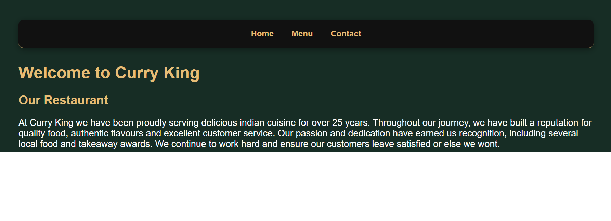

# Curry-King-Test-Website1
A modern, responsive restaurant website created as a web development project, inspired by Indian cuisine.

About the project

This project showcases a restaurant website designed with a clean layout and a black-and-gold colour theme. It highlights popular Indian dishes and provides visitors with information about the restaurant.

Features

.Responsive design for mobile and desktop
.Black and gold styling
.Food menu with four featured dishes
.Interactive food cards with hover effects
.Order Now buttons with pop up messages
.About us section
.Navigation website

Technologies Used
.HTML5
.CSS3

What I Learned

Through this project, I developed my skills in HTML, CSS, responsive design, styling and publishing websites using GitHub Pages.

Created as a personal project.

## Website Preview

